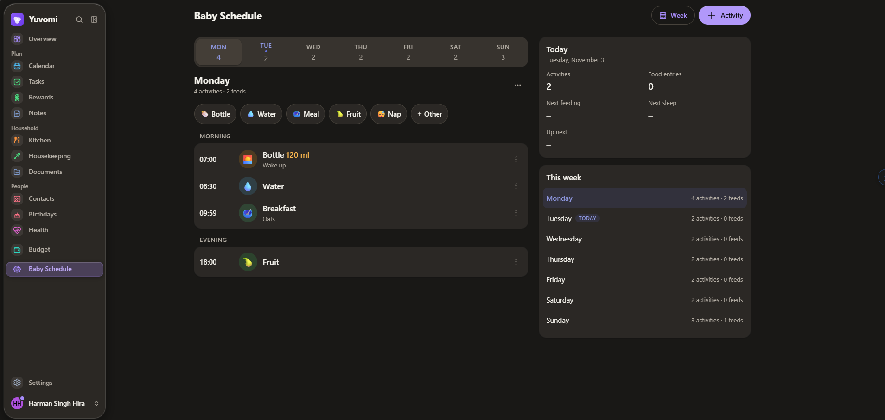
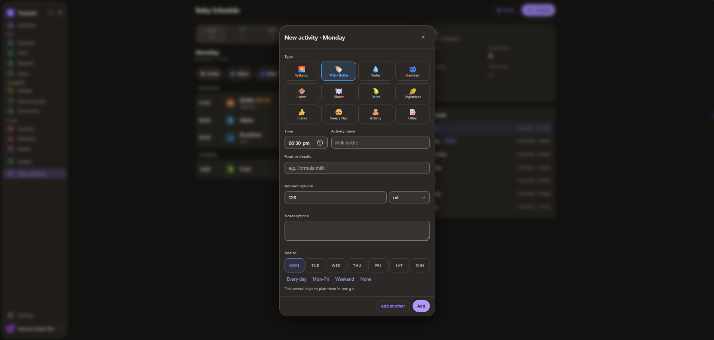

# Baby Schedule for Yuvomi

Plan your baby's week together: bottles, water, meals, fruit, naps and sleep,
Monday to Sunday. Both parents edit the same schedule from their phones and see
each other's changes within seconds.





## Features

- **Week at a glance:** tap a day or swipe between days; each day shows its
  activities as a timeline with the time, an emoji and the amount (120 ml, 1.5 hours).
- **Fast planning:** quick-add buttons (Bottle, Water, Meal, Fruit, Nap), add one
  activity to several days at once, and "Add another" to fill a whole day in one go.
- **Week tools:** copy a day, repeat an activity, move or duplicate it, save the
  week as a template, start from an example day, clear a day or the week.
- **Today overview:** up next, next feeding, next sleep and food entries.
- **Home screen widget:** "Baby today" shows what's next for the baby.
- **"Today at a glance" and Wall Mode:** the baby's next activity appears as one
  task. Tick it off and the next one appears.
- **Roles:** uses Yuvomi's permissions, so a member can be given view-only access.

## Install

On the server where Yuvomi runs, as root:

```sh
curl -fsSL https://cdn.jsdelivr.net/gh/HSinghHira/Baby-Schedule-Module-for-Yuvomi@main/install.sh | sh
```

The script installs everything and adds the module to Yuvomi. If your Yuvomi is
behind a proxy (Cloudflare Tunnel, Nginx Proxy Manager, ...), it shows the one
route to add and waits until it works.

Then, as an admin in Yuvomi:

1. Open **Baby Schedule** in the menu.
2. Optional: **Settings → Modules → Baby Schedule → Turn on** to show the baby's
   next activity in "Today at a glance" and Wall Mode.
3. Optional: switch on the **Baby today** widget with **Customize** on the home screen.

To update, run the same command again. Your schedule is kept.

**Requirements:** Docker, and a Yuvomi with a modules folder (ZimaOS / IceStore,
Unraid, TrueNAS, Portainer, plain Docker; not Umbrel).

**Options:** `BS_DOMAIN`, `BS_PORT`, `BS_DATA`, `BS_GATEWAY=1` (no proxy in front
of Yuvomi) and `YUVOMI_CONTAINER`. Put them before `sh`, for example
`... | BS_PORT=6600 sh`. Details at the top of [install.sh](install.sh).

**Backup:** the schedule is stored in its own folder (`/DATA/AppData/baby-schedule/data`
on ZimaOS). Yuvomi's own backup does not include it.

## Languages

English is included. To add a language, copy
`modules/baby-schedule/locales/en.json` to `locales/<code>.json` (for example
`de.json` or `hi.json`) and translate the text.
